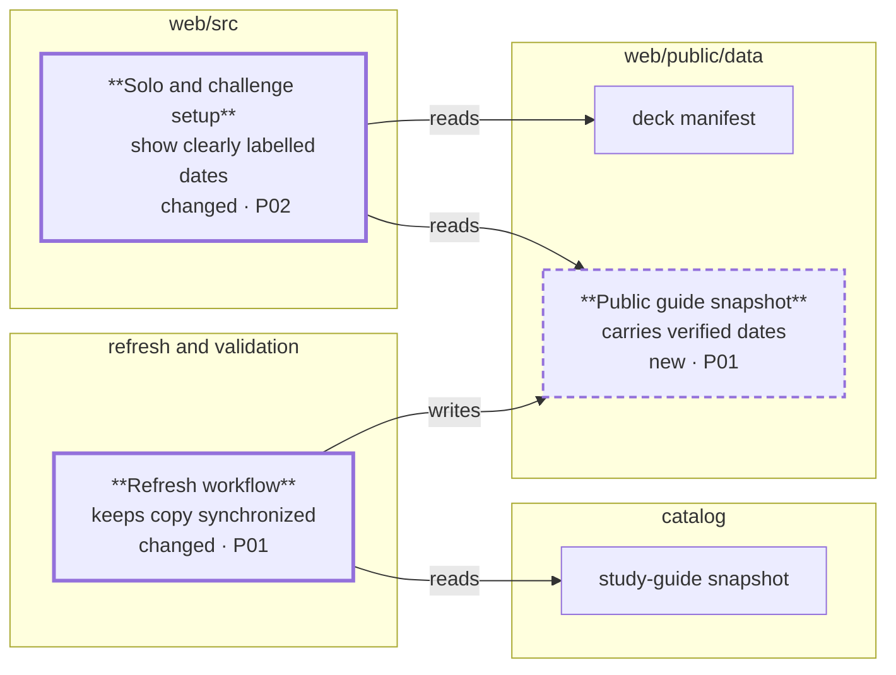

# RPI Plan: Exam update date

## Task Metadata

* Task ID: `exam-update-date`
* Task slug: `exam-update-date`
* Plan date: 2026-11-08

## Executive Summary

Show the selected exam's flashcard deck generation date next to the official Microsoft Learn study-guide page's last-updated date in the solo and challenge setup views. Deliver the guide snapshot as a checked-in public asset, kept in sync by the existing weekly refresh, and label both dates explicitly in English and French.

Implementation is complete and ready for review. The standard critique identified workflow and validation gaps, addressed during planning. Date freshness still depends on review and deployment.

### What You May Not Know

The site currently shows neither date. The deck date comes from a CSV filename, while the guide date is a page-update date, not proof of an exam-objective change or deck alignment. Production Pages builds do not run the data generator.

## Phase Checklist

### After

The refresh workflow produces the public snapshot in P01; both setup views read it and the existing deck manifest in P02. Thick borders indicate changed parts, dashed borders indicate new parts.

<!-- rpi:phase id=P01 -->
### [x] P01: Publish the guide snapshot reliably

Goals:
* Make the reviewed guide-page dates available to the static web app, without changing deck version semantics or requiring a network call during build.

Dependencies:
* None.

Changes in the map: refresh workflow and public guide snapshot.

<!-- rpi:task id=P01-T01 -->
#### [x] P01-T01: Maintain a verifiable public snapshot

Goals:
* Provide a public snapshot that corresponds exactly to the canonical catalog after the weekly PR is merged; live visibility additionally requires successful deployment.

Requirements:
* FR-002, NFR-001, NFR-003.

Details:
* Publish a byte-identical copy of [catalog/study-guide-dates.json](../../../catalog/study-guide-dates.json) at [web/public/data/study-guide-dates.json](../../../web/public/data/study-guide-dates.json); preserve `pageUpdatedOn`, `guideUrl`, `code` and snapshot `retrievedAt`. Do not modify `updatedOn` or `deckVersion`.
* Add [tools/sync-study-guide-public.mjs](../../../tools/sync-study-guide-public.mjs) with default sync and `--check` modes: copy canonical bytes to the named public asset, or exit nonzero on missing or differing data without writing. Use the same command locally and in CI.
* In the weekly workflow run sync after refreshing the canonical snapshot and before scope verification and staging; run its `--check` and tests before scope verification. Add only [web/public/data/study-guide-dates.json](../../../web/public/data/study-guide-dates.json) to the allowlist, changed-file detection, `git add` and PR description. Preserve existing token permissions.
* Run `node tools/sync-study-guide-public.mjs --check` unconditionally in both [.github/workflows/api-infrastructure.yml](../../../.github/workflows/api-infrastructure.yml) validation and [.github/workflows/deploy-site.yml](../../../.github/workflows/deploy-site.yml) before the build, including endpoint-cutover mode. The production workflow deliberately runs `tsc` and `vite build` without `build:data`.
* A newly added deck absent from an older valid snapshot is allowed and displays unavailable, rather than blocking all exams. Malformed snapshots or mismatched copies fail the explicit check rather than silently presenting wrong data. Do not fetch Microsoft Learn from the browser.
* Extend [tools/exam-date-report.test.mjs](../../../tools/exam-date-report.test.mjs) for identical, missing and mismatched copies and refresh output/allowlist. Run `node --test tools/exam-date-report.test.mjs` in refresh and API validation; the standalone check protects the Pages path. Do not regenerate translated decks for a guide-only refresh.

References:
* [catalog/study-guide-dates.json](../../../catalog/study-guide-dates.json): canonical snapshot.
* [.github/workflows/refresh-exam-date-report.yml](../../../.github/workflows/refresh-exam-date-report.yml): scheduled PR and strict file scope.
* [.github/workflows/deploy-site.yml](../../../.github/workflows/deploy-site.yml): deployment uses checked-in data.
* [.github/workflows/api-infrastructure.yml](../../../.github/workflows/api-infrastructure.yml): pull-request validation and deployment prerequisite.
* [tools/exam-date-report.test.mjs](../../../tools/exam-date-report.test.mjs): existing offline fixture and workflow checks.

Dependencies:
* None.

<!-- rpi:phase id=P02 -->
### [x] P02: Show distinct dates at exam selection

Goals:
* Let learners see and distinguish their deck's generation date and the official guide page's last update for the selected exam.

Dependencies:
* P01.

Changes in the map: solo and challenge setup.

<!-- rpi:task id=P02-T01 -->
#### [x] P02-T01: Display accessible, localized date metadata

Goals:
* Show both dates beside the selected exam in both setup views, without impacting practice or challenge sessions.

Requirements:
* FR-001, FR-002, FR-003, FR-004, NFR-002, NFR-003.

Details:
* Read the manifest's `updatedOn` as the deck generation date and match the public snapshot by canonical exam code, not array position or title. Reuse shared metadata rendering/loading across views where appropriate; do not change translated deck metadata or use the challenge deck cache as guide source.
* Render plain, localized labels distinguishing deck generation and study-guide page update, with a link to the matching official guide; use only validated canonical guide URLs. The data is a snapshot, not an assertion that the exam or deck changed, and must not imply deck freshness or alignment.
* Use date-only formatting in the active app language with a fixed timezone (or equivalent), so ISO calendar dates never shift by a day. Do not reuse the existing timestamp-oriented `formatDate` unchanged.
* Before selection, show no selected-exam dates; on selection changes, immediately show the matching deck and guide data. Missing guide entries produce a localized unavailable state. Failed or invalid guide data produces a localized error while leaving exam selection and practice usable; do not invent a date or substitute the deck date.
* Keep existing select option text and keyboard behavior intact; support narrow layouts and both light/dark themes. Document what the two dates mean and how snapshot refresh reaches the live site.

References:
* [web/src/App.tsx](../../../web/src/App.tsx): solo exam selector and manifest loading.
* [web/src/challenge/ChallengeViews.tsx](../../../web/src/challenge/ChallengeViews.tsx): challenge exam selector.
* [web/src/types.ts](../../../web/src/types.ts): existing exam summary.
* [web/src/i18n/locales/en.json](../../../web/src/i18n/locales/en.json) and [web/src/i18n/locales/fr.json](../../../web/src/i18n/locales/fr.json): localized strings.
* [web/README.md](../../../web/README.md): web operation documentation.

Dependencies:
* P01-T01.

<!-- rpi:task id=P02-T02 -->
#### [x] P02-T02: Verify the end-to-end date contract

Goals:
* Catch wrong dates, stale data, rendering regressions, and broken exam workflows before release.

Requirements:
* FR-001, FR-002, FR-003, FR-004, NFR-001, NFR-002, NFR-003.

Details:
* Add focused tests covering two exams with different dates, selection changes, missing entries, malformed/failed snapshot loads, English and French, both setup modes, and a negative UTC offset that must not move the displayed day. Assert the official link and distinct labels; verify no date before selection and no loss of session functionality.
* Test keyboard navigation to the guide link, visibility of both labels at a narrow viewport, and visibility in both light and dark themes. Static text labels need not be focusable.
* Test ownership: P01-T01 owns offline copy and workflow tests in `tools/exam-date-report.test.mjs`; this task owns UI/loader tests in at most one new `web/src/**/*.test.ts` Vitest file and one new `web/tests/e2e/*.spec.ts` Playwright file. Extend existing suites as needed; remove no existing tests. The canonical snapshot is the source, the public snapshot is generated, and no existing English/French deck JSON is newly canonical.
* Run `node --test tools/exam-date-report.test.mjs` and `node tools/sync-study-guide-public.mjs --check` from the repository root. From `web`, run targeted `npx vitest run <test-file>`, `npx playwright test <spec-file>`, `npm run validate:data`, `npm run lint`, and deploy-equivalent `npx tsc -b` followed by `npx vite build`. Use the existing Playwright setup; record any platform-specific inability to run it rather than claiming success.

Guidance:
* [web/src/ExamDates.tsx](../../../web/src/ExamDates.tsx) shares the display between views; [web/src/studyGuideDates.ts](../../../web/src/studyGuideDates.ts) validates, loads, and formats the snapshot dates.
* On Windows, the existing Playwright service command uses Unix-only environment assignment. Use equivalent session-only services and configuration for browser checks rather than changing the repository's unrelated test infrastructure.

References:
* [web/tests/e2e/gh300.spec.ts](../../../web/tests/e2e/gh300.spec.ts): solo and localization test patterns.
* [web/tests/e2e/challenge.spec.ts](../../../web/tests/e2e/challenge.spec.ts): challenge test patterns.
* [web/playwright.config.ts](../../../web/playwright.config.ts): test services and browser configuration.
* [web/package.json](../../../web/package.json): test and build commands.

Dependencies:
* P02-T01.

## User Decisions and Requirements

### Confirmed User Direction

* Research and plan the feature; the later `/rpi-implement` invocation authorizes implementation.
* “Exam latest update” means the Microsoft Learn study-guide page last-updated date.
* Show the deck generation date and study-guide update date together beside the selected exam.

### Planning Decisions and Feedback

| Group | Decision | Status | Owner | Rationale | Evidence | Planning impact |
|---|---|---|---|---|---|---|
| D1 | Update date semantics | Confirmed | User | Study-guide page date, not objective-effective date. | User choice; [research](../../research/2026-11-08/exam-update-date-research.md) | FR-002. |
| D2 | Accompanying date | Confirmed | User | Show deck generation date and guide date together. | User choice; [research](../../research/2026-11-08/exam-update-date-research.md) | FR-001 and FR-002. |

## Planning Readiness and Next Step

* Planning execution: complete; readiness: ready. All critique findings were resolved in the plan.
* Decision participation: user-owned, standalone planning; no unresolved user decisions.
* Critique: standard, complete, initial verdict Revise; all findings resolved in this plan. [.copilot-tracking/reviews/plans/2026-11-08/exam-update-date-plan-critique.md](../../reviews/plans/2026-11-08/exam-update-date-plan-critique.md).
* Research: [.copilot-tracking/research/2026-11-08/exam-update-date-research.md](../../research/2026-11-08/exam-update-date-research.md).
* Plan: [.copilot-tracking/plans/2026-11-08/exam-update-date-plan.md](exam-update-date-plan.md).
* Changes record: [.copilot-tracking/changes/2026-11-08/exam-update-date-changes.md](../../changes/2026-11-08/exam-update-date-changes.md).
* Continuation owner: user; full-plan implementation is complete and eligible for review.

## Goals

* Show truthful, accessible date context without mistaking guide updates for changes to the exam or the flashcards.

## Scope and Non-Goals

* In scope: static snapshot delivery, refresh synchronization, solo and challenge selection, localization, tests, and directly related documentation.
* Non-goals: changing deck versioning, assessing alignment, querying Microsoft Learn at runtime, implementing the feature in this planning phase, or publishing changes.

## Functional Requirements

* FR-001: Show the selected exam's CSV-derived deck generation date, clearly labelled.
* FR-002: Show the matched official study-guide page's last-updated date, clearly labelled, with its official guide link.
* FR-003: Show both dates in solo and challenge setup, update them on exam selection, and show no selected-exam dates before selection.
* FR-004: Represent missing guide data as unavailable and load/validation failures as errors without preventing normal practice.

## Non-Functional Requirements

* NFR-001: The committed public snapshot must exactly match the canonical snapshot and the weekly PR must include it. Verify with a deterministic offline check and refresh tests.
* NFR-002: Dates preserve the original calendar day in English and French, including a negative UTC offset; labels and link remain keyboard accessible on narrow layouts.
* NFR-003: Existing deck versions, translated deck parity, exam selection and practice behavior remain unchanged; verify with focused regression tests and build.

## Risks and Open Questions

| Priority | Type | Risk | Affected work | Impact | Smallest action | Owner |
|---|---|---|---|---|---|---|
| M | Risk | Snapshot refresh needs PR merge and successful deployment. | P01-T01 | Data may lag official source. | Document snapshot and delivery behavior; do not promise live data. | Implementer |
| M | Risk | Guide page updates do not establish changed objectives or aligned flashcards. | P02-T01 | Learner may infer unsupported claims. | Use precise labels and documentation. | Implementer |

## Dependencies

* The canonical guide snapshot and existing manifest are available in the repository; CI and deployment must preserve their synchronization.

## Sources

* [.copilot-tracking/research/2026-11-08/exam-update-date-research.md](../../research/2026-11-08/exam-update-date-research.md): C1–C5 ground data, UI and deployment decisions.
* No BRD, PRD or ADR was identified by repository filename search; user decisions are authoritative.

## Critique Disposition

* Setting: standard, default. Execution: complete. Initial verdict: Revise; all five findings resolved below.
* Limitations: static critique only; Mermaid light/dark rendering not verified.

| Finding | Disposition | Owner | Resolving evidence | Decision route |
|---|---|---|---|---|
| PC-001 | Resolved | Planner | P02-T02 specifies keyboard, narrow layout and theme checks. | Direct correction |
| PC-002 | Resolved | Planner | P02-T02 explicitly runs `npm run validate:data`. | Direct correction |
| PC-003 | Resolved | Planner | P01-T01 distinguishes merge from successful deployment. | Direct correction |
| PC-004 | Resolved | Planner | P01-T01 names the check, runners and both CI workflow steps. | Direct correction |
| PC-005 | Resolved | Planner | P01-T01 defines synchronization before verification and staging. | Direct correction |

## Artifact Self-Check

* The requirements, task IDs, dependencies, change map, decision record, test ownership and sources are drafted.
* Mermaid rendering in light and dark themes has not been verified.
* Standard critique completed; all actionable findings are resolved. Existing generated deck JSON remains outside the new canonical data path.

## Follow-Up Items

* None.

## Handoff

* Full-plan implementation is recorded in [.copilot-tracking/changes/2026-11-08/exam-update-date-changes.md](../../changes/2026-11-08/exam-update-date-changes.md); review may proceed.
